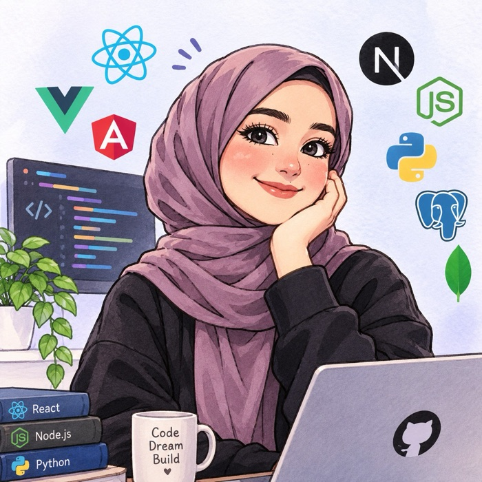
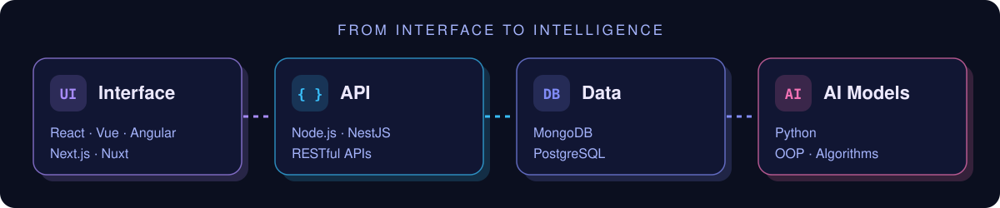

  

  

## About me

I'm a junior full-stack developer with a strong background in both frontend and backend. I build complete web applications, from the user interface to the API and the database, and I develop AI models in Python.

- Builds **full-stack web applications** with modern JavaScript frameworks
- Develops **AI models and modules** in **Python**
- Comfortable across the stack: **React, Vue, Angular, Next.js, Nuxt** on the frontend, **Node.js / NestJS** on the backend
- Solid foundations in **OOP, algorithms and data structures**
- Focused on clean, readable and maintainable code

 

  

## Tech stack

  

  

<!-- TODO: fill in real projects, then remove these comment markers
## Featured projects

| Project | What it does | Built with |
|---|---|---|
| **[Project name](https://github.com/EsraaAnwer23/project-1)** | One line on what the web app does and who it's for | `Next.js` `NestJS` `PostgreSQL` |
| **[Project name](https://github.com/EsraaAnwer23/project-2)** | One line on what the AI model predicts or classifies | `Python` |
| **[Project name](https://github.com/EsraaAnwer23/project-3)** | One line on the REST API and its main features | `Node.js` `MongoDB` |
| **[Project name](https://github.com/EsraaAnwer23/project-4)** | One line on the frontend app | `Vue` `Nuxt` |

<b>More projects</b>

 

| Project | What it is |
|---|---|
| **Project name** | Short description |
| **Project name** | Short description |

-->

## GitHub stats

  
  

  

<!-- TODO: fill in, then remove these comment markers
## Right now

- Building: [current project]
- Learning: [e.g. TypeScript, Docker, deploying AI models]
- Open to junior full-stack roles, internships and freelance projects

-->

## Let's connect

I'm open to opportunities and collaborations. Feel free to reach out.

  <!-- TODO add real LinkedIn URL:  -->
  <!-- TODO add real email:  -->
  

